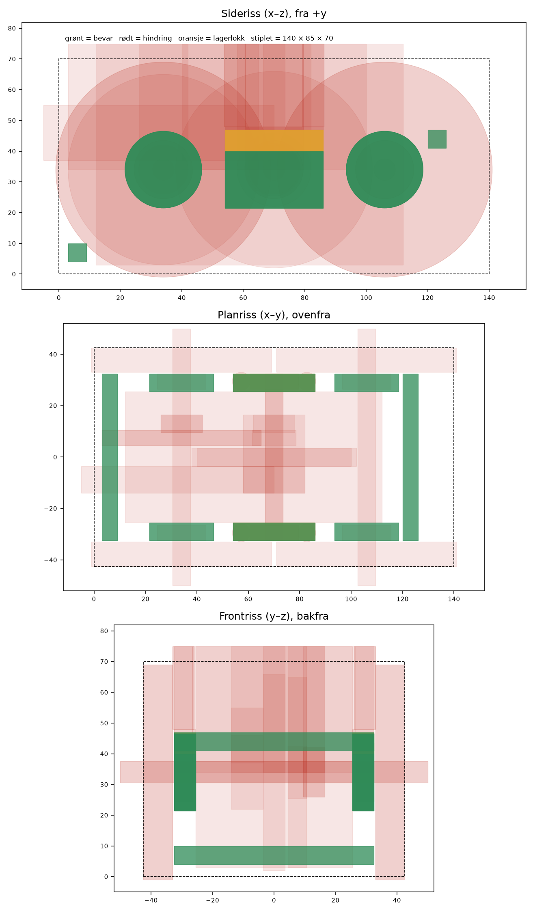

# Generativ ramme for KERS-bilen – oppsett i Fusion

Inspirert av kapittel 7 i *KERS bil.pdf*: bevart geometri, hindringer, lasttilfeller og maksimal stivhet med massemål. Hall-sensoren brukes bare på teststasjonen og er ikke med i rammen. Mål fra drivverk-tegningen: aksler Ø6 på z = 34 (x = 34 / 70 / 106), seks 626-lagre med innerflate på y = ±26,5, Ø68 hjul, svinghjul Ø60 × 6, tannhjul z73.

## 1. Bygg modellen

1. Fusion: **Utilities → Add-Ins → Scripts and Add-Ins → + → Script or add-in from device**. Velg mappen `Code/Fusion/KERS_GD_oppsett`.
2. Marker `KERS_GD_oppsett` og trykk **Run**. Skriptet lager et nytt design med tre komponenter:

| Komponent | Innhold | Rolle i studien |
|---|---|---|
| GD Bevar (8) | 4 lukkede lagerhus (bak, foran), 2 U-seter for svinghjulslagrene, tverrbjelke foran (gripepunkt) og bak i full bredde | Preserve |
| GD Hindring (34) | innerrom (holder midten åpen, så rammen blir et rektangel), hjul, aksler, lagre, svinghjul, tannhjul, pinjong, nav, trommel, snorbane, monteringsbaner, lokkrom, skrutrekkerbaner (halvgjennomsiktige) | Obstacle |
| GD Grenser (6) | 140 × 85 × 70 og 3 mm bakkeklaring. Skjult ved start, slå på øyet før du velger dem | Obstacle |
| Lagerlokk (2) | Lokkene som skrus på U-setene | Velges ikke, printes separat |

Modellen bygges med Z opp. Står Fusion på Y opp, ser bilen ut til å ligge på siden, men det påvirker ikke studien.

Alle mål står øverst i skriptet. Kjør `python3 Code/Fusion/gd_forhandsvisning.py` etter en endring. Det sjekker at ingen bevar-kropp overlapper en hindring, for da avviser Fusion studien.

**Hvorfor U-seter:** svinghjulet er sveiset på akselen, og akselen er like lang som avstanden mellom lagrenes ytterflater. Svinghjulet kan derfor ikke tres inn i lukkede lagerhus i en ramme i ett stykke. Det løftes ned ovenfra med lagrene på akselendene, og lokkene skrus på med 2 × M3 × 16 per side. Bak- og forakselen stikkes inn utenfra gjennom lukkede lagerhus, og tannhjulet senkes ned ovenfra og tres på. Monteringsbanene er hindringer, så rammen ikke vokser inn der delene må passere.

## 2. Studie

**Design → Generative Design → Define → New Study → Structural Component**

- **Preserve:** alle kropper i *GD Bevar*.
- **Obstacle:** alle kropper i *GD Hindring* og *GD Grenser*.
- **Starting shape:** ingen i første runde. Den andre gruppa brukte en, men den er ikke nødvendig.

### Lasttilfelle 1 – Opptrekk (bilen holdes i fremre tverrbjelke og snora dras bakover)

| | Hvor | Verdi |
|---|---|---|
| Fixed | Over- og undersiden av *Tverrbjelke foran*, midtpartiet | – |
| Bearing load | Boringen i *U-sete svinghjul +y* | 25 N, retning −x (bakover) |
| Bearing load | Boringen i *U-sete svinghjul −y* | 25 N, retning −x |

50 N totalt er samme snorkraft som den andre gruppa antok. Mål gjerne deres egen med en bagasjevekt.

### Lasttilfelle 2 – Nedsetting med svinghjulet i gang

| | Hvor | Verdi |
|---|---|---|
| Pin | Boringene i *Lagerhus bak ±y* | Radial og aksial fast |
| Pin | Boringene i *Lagerhus foran ±y* | Bare radial fast, **ikke aksial** |
| Bearing load | Boringene i begge U-setene | 10 N hver, retning −z |

Svinghjulet veier omtrent 0,13 kg. 20 N tilsvarer at bilen settes ned med cirka 15 g støt. Erfaringen fra den andre gruppa var at overbegrensning i sideretning ga altfor optimistisk stivhet, derfor er forakselen fri aksialt.

### Lasttilfelle 3 – Sidestøt

Samme begrensninger som tilfelle 2, og en kraft på 10 N i +y på *Tverrbjelke foran*. Det gir rammen stivhet sideveis, slik at lagrene ikke vris i forhold til hverandre.

### Lasttilfelle 4 – Klem bak (bilen holdes bak mellom fingrene)

| | Hvor | Verdi |
|---|---|---|
| Fixed | Over- og undersiden av *Tverrbjelke foran* | – |
| Force | Den flate yttersiden (y = +32,5) av *Lagerhus bak +y* | 20 N, retning −Y (innover) |
| Force | Den flate yttersiden (y = −32,5) av *Lagerhus bak −y* | 20 N, retning +Y (innover) |

### Lasttilfelle 5 – Vridning (bilen settes ned skjevt, ett bakhjul treffer først)

| | Hvor | Verdi |
|---|---|---|
| Fixed | Over- og undersiden av *Tverrbjelke foran* | – |
| Force | Ø19-boringen i *Lagerhus bak +y* | 10 N, retning +Z |
| Force | Ø19-boringen i *Lagerhus bak −y* | 10 N, retning −Z |

**Hvorfor 4 og 5 trengs:** i tilfelle 2 og 3 er begge de bakre lagerhusene låst med Pin. Innspenningen virker da som en uendelig stiv tverrbjelke bak, og studien ser ingen grunn til å bruke den ekte. Første kjøring ga derfor en åpen U-form med den bakre bjelken på en tynn stilk. Tilfelle 4 og 5 holder bare fronten fast, så rammen må selv bære klemming og vridning bak. Det gjør en lukket ramme langt bedre enn en åpen U.

### Mål og grenser

- **Objective:** Maximize Stiffness
- **Mass target:** 0,040 kg. Bevar-kroppene alene veier 19 g i PLA, så det blir 21 g igjen til sideskinner og hjørner. MDF-kroppen veier rundt 45 g.
- **Safety factor:** 2
- **Material:** ABS, eller PLA hvis den finnes i biblioteket.

### Produksjon

- **Unrestricted** og **Additive** i samme studie, så dere kan sammenligne.
- **Additive:**
  - Byggeretning langs **Y**: rammen printes liggende på siden, så lagerboringene blir runde.
  - Overheng 45°.
  - Minste tykkelse 2,0 mm, som er fem perimetre med 0,4-dyse.

Kjør med **Generate**. Studien kjøres i skyen.

## 3. Etter studien

1. **Velg resultat:** sammenlign stivhet, masse og om resultatet er realistisk å printe. Den andre gruppa valgte det mest robuste, ikke det letteste.
2. **Lag modell:** bruk **Create Design From Outcome**. Bevart geometri beholdes nøyaktig, så boringene blir Ø19,0 mm.
3. **Testprint boringene først:**
   - Print en ring med boringer på Ø18,9 / 19,0 / 19,1 / 19,2 i samme retning som rammen.
   - Endre `D_LAGER` i skriptet etter resultatet og kjør skriptet på nytt.
   - FDM-hull blir ofte litt for små.
4. **Lagerlokk:** print lokkene fra *Lagerlokk (printes separat)*.
   - Skruehullene i U-setene er Ø2,8 × 10 dybde for M3 skrudd rett i PLA. Lokket har Ø3,4 klaringshull og er 7 mm tykt, så bruk **M3 × 16**. Det gir 9 mm gjengeinngrep.
   - Godset rundt hullene er bare 1,6–1,9 mm. Skru forsiktig første gang, så skruen former gjengene uten å sprekke PLA-en. Gjengeinnsatser (Ø4) får ikke plass.
5. **Sjekk med kollisjonstest:** kjør *Interference* mellom rammen og drivverket i sammenstillingen før dere printer.

## Åpent

- **Akselengden:** svinghjulsakselen er satt til 65 mm, som i oppgaveteksten (`L_SV_AKSEL`). Er den utdelte akselen 85 mm, går akselendene inn i hjulene, og drivverket må endres før studien kjøres.
- **Kraftene er antatt:** særlig snorkraften. En enkel måling gjør studien mer forsvarlig i rapporten.
